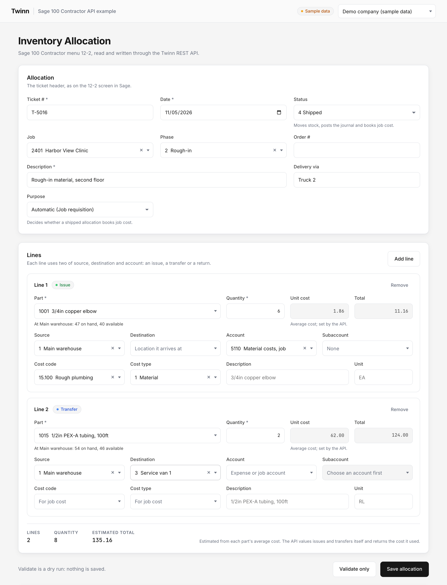
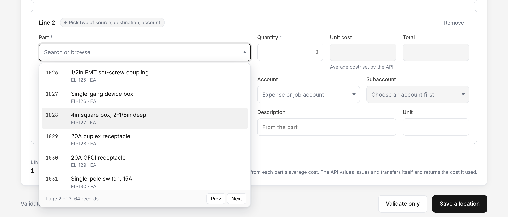
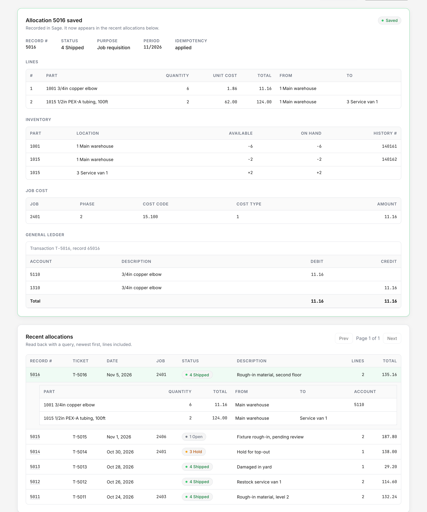
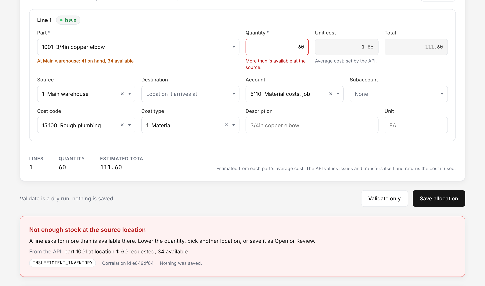

# Sage 100 Contractor API example: Inventory Allocation

A working example of reading and writing Sage 100 Contractor data through the [Twinn REST API](https://twinn.engineering/developers). It recreates the 12-2 Inventory Allocation screen as a small web app: pick a job, parts and locations from the company's own records, check the allocation against the books with a dry run, then record it in Sage and see it come back in a query.

The code is meant to be read and copied. The frontend is React, Vite and TypeScript. A small Node backend holds the API keys and forwards calls to the API, because a key must never reach a browser.



## What it does

- **Reads** the records the screen needs: jobs and phases, parts, inventory locations, stock on hand and available per location, ledger accounts and subaccounts, cost codes and cost types. Every one of those fields is a searchable dropdown that loads 25 records at a time from the server.
- **Writes** the allocation with `POST /inventory-allocations`, first as a dry run if you press Validate, then for real when you press Save.
- **Shows the effects** the API reports back: the record number, the cost and total the server used for each line, inventory movements, job cost, and the general ledger transaction.
- **Reads the write back** in a list of recent allocations, newest first, with their lines.

| Paginated, searchable dropdowns | A saved allocation and its postings |
| --- | --- |
|  |  |

When the API refuses an allocation, the app shows the reason and marks the field that caused it:



## Quick start

You need Node 20 or later.

### 1. With sample data (no key needed)

```sh
npm install
npm run dev:mock
```

Open http://localhost:5173. The backend serves a fictional company from `server/mock/fixtures.json` and imitates the API's answers, including a successful write and an `INSUFFICIENT_INVENTORY` refusal (ask for more than 40 of part 1001 from the main warehouse at status 4). Saved allocations are kept in memory until you stop the server.

### 2. With the demo company

Twinn runs a demo company with fictional Sage 100 Contractor books at `demo.twinn.engineering`. To get an API key for it, ask for a demo key at [twinn.engineering](https://twinn.engineering). Then:

```sh
cp .env.example .env
# put the key in COMPANIES in .env
npm run dev
```

If the key you are given is read only, the dropdowns and the recent allocations work, and the API refuses Validate and Save with `COMPANY_READ_ONLY`, which the app shows as a message.

### 3. With your own company

Your company's API is at `https://dashboard.twinn.engineering/api/v3`, with a key issued for that company. Add it to `.env` as another entry and pick it from the company selector in the top bar.

## Configuration

The backend reads `.env` (see [`.env.example`](.env.example)). One API key reaches one Sage company, so each company you want to use is one entry with its own key:

```sh
COMPANIES=[{"id":"demo","label":"Demo company","baseUrl":"https://demo.twinn.engineering/api/v3","apiKey":"opdc_v3_dev_..."},{"id":"main","label":"Our company","baseUrl":"https://dashboard.twinn.engineering/api/v3","apiKey":"..."}]
```

If a JSON value is awkward where you deploy, use numbered variables instead: `COMPANY_1_ID`, `COMPANY_1_LABEL`, `COMPANY_1_BASE_URL`, `COMPANY_1_API_KEY`, then `COMPANY_2_...`.

The browser only learns each company's `id` and `label` (from `GET /api/companies`). Every call it makes names the company in the path, and the backend checks that id against its configuration before adding that company's key. Keys are never logged.

| Variable | Default | Meaning |
| --- | --- | --- |
| `COMPANIES` or `COMPANY_n_*` | | The companies and their keys. |
| `MOCK` | | `1` serves the fictional sample company instead of calling the API. |
| `MOCK_ASYNC` | | With `MOCK=1`, `1` answers every write with `202` so you can watch the app follow it. |
| `API_PORT` | `8787` | The backend's port. Vite proxies `/api` to it. |
| `WEB_PORT` | `5173` | The Vite dev server's port. |

## How the write works

The form builds an `InventoryAllocationInput` (see `src/lib/allocation.ts`) and sends it through the backend to `POST /api/v3/inventory-allocations`.

**Each line uses two of Source, Destination and Account**, as on Sage's own grid. Source and Account is an issue (stock leaves a location and is costed to an expense or job account). Source and Destination is a transfer between locations. Destination and Account is a return into stock, which needs the unit cost it comes back at. The app checks this before sending; the API checks it again.

**The server values the stock.** On an issue or a transfer the API ignores any cost you send and uses the part's average cost (or the company's FIFO or LIFO layers), then reports the cost and total it used for each line. The form shows an estimate from the part's average cost until the answer comes back.

**Status decides what moves.** 1 Open and 2 Review record the allocation and move nothing. 3 Hold lowers the quantity available at the source. 4 Shipped moves the stock, posts the journal and, for a job requisition, books job cost under each line's cost code and cost type.

**Validate is a dry run.** It sends `?dryRun=true`. The API runs the whole allocation against the company's live books inside a transaction and rolls it back, so you see the real costs and postings and nothing is saved. Record numbers in a dry-run answer are provisional and are never used.

**Save is idempotent.** Each save sends a new `Idempotency-Key` (a UUID). If the answer is lost or the API reports that the outcome is unknown (`504`), the app keeps the key and offers to try again; the API replays the stored answer instead of recording the allocation twice. Any change to the form makes the next save a new request with a new key.

**A slow write answers `202`.** The app sends `Prefer: wait=25`, so the API holds the call for up to 25 seconds. If Sage takes longer, the API answers `202 Accepted` with a `Location` header naming `/api/v3/requests/{id}`. A `202` is not a success: the app follows `Location` with `GET /requests/{id}?wait=25` until the request has an outcome, which is exactly the answer the original call would have given. See `postAllocation` in `src/api/client.ts`.

**Errors are problem documents.** A refusal comes back as `application/problem+json` with an error code in `X-Error-Code`, and field errors as JSON paths such as `lines[0].quantity`. `src/lib/errors.ts` turns the common codes (`INSUFFICIENT_INVENTORY`, `COST_LAYERS_SHORT`, `FIELD_REQUIRED`, `FIELD_INVALID`, `PERIOD_CLOSED` and others) into a message, and binds each field error to the input it belongs to.

## How the dropdowns read

Every selection field uses one component, `src/components/Combobox.tsx`, fed by `src/lib/paging.ts`:

- With nothing typed, it pages through `POST /{entity}/query` with `page: { pageNumber, pageSize: 25 }` and shows the total from the response.
- A number looks the record up with a query filter on its number field.
- Text is sent to `POST /{entity}/match` after a short pause in typing. Matching ranks names by edit distance and also finds a word inside a longer name, so "harbor" finds "Harbor View Clinic". The API does not page match results, so the app asks for one more hit than it has shown and slices.

Phases are scoped to the chosen job and subaccounts to the chosen account with a `filters` clause. The component follows the WAI-ARIA combobox pattern: arrow keys move, Enter picks, Escape closes, Page Down and Page Up change page.

## Project layout

```
server/                 Node backend (Hono)
  app.ts                the proxy routes and the entity allowlist
  config.ts             reads the companies and keys from the environment
  upstream.ts           the only code that calls the API and adds the key
  mock/                 MOCK=1: fictional fixtures and a small imitation of the API
src/                    React frontend
  api/schema.d.ts       types generated from the OpenAPI document
  api/client.ts         calls to the backend, including following a 202
  lib/allocation.ts     the form model, line rules and the request body
  lib/paging.ts         query and match pages for the dropdowns
  lib/lookups.ts        what each dropdown reads and shows
  lib/errors.ts         error codes to messages and field errors
  components/           Combobox, the header and lines cards, the result, recent allocations
api/openapi.json        the part of the Twinn OpenAPI document this app uses
scripts/gen-api.mjs     regenerates api/openapi.json and src/api/schema.d.ts
e2e/                    Playwright smoke test and the screenshot script
docs/screenshots/       the images above
```

The backend exposes these routes to the browser:

| Route | Calls |
| --- | --- |
| `GET /api/companies` | nothing: lists configured company ids and labels |
| `POST /api/:company/query/:entity` | `POST /{entity}/query` |
| `POST /api/:company/match/:entity` | `POST /{entity}/match` |
| `POST /api/:company/inventory-allocations` | `POST /inventory-allocations`, with `Idempotency-Key`, `Prefer` and `dryRun` |
| `GET /api/:company/requests/:id` | `GET /requests/{id}` |

Only the entities this screen needs can be read through it.

## Scripts

| Script | Does |
| --- | --- |
| `npm run dev` | backend and Vite together, using `.env` |
| `npm run dev:mock` | the same with sample data |
| `npm run build`, `npm start` | build the frontend, then serve it and the API routes from one port |
| `npm test` | unit tests (Vitest) |
| `npm run e2e` | Playwright smoke test against the sample data |
| `npm run screenshots` | retake the images in `docs/screenshots/` |
| `npm run lint`, `npm run typecheck` | ESLint and TypeScript |
| `npm run gen:api` | regenerate the API types from https://twinn.engineering/openapi.v3.json (or a path you pass) |

Playwright needs a browser the first time: `npx playwright install chromium`.

## Related

- [Twinn API reference and guides](https://twinn.engineering/developers)
- [Sage 100 Contractor MCP server](https://github.com/twinn-eng/sage-100-contractor-mcp), for asking questions of the same data from an AI assistant

## License

[MIT](LICENSE), copyright Twinn Engineering.
